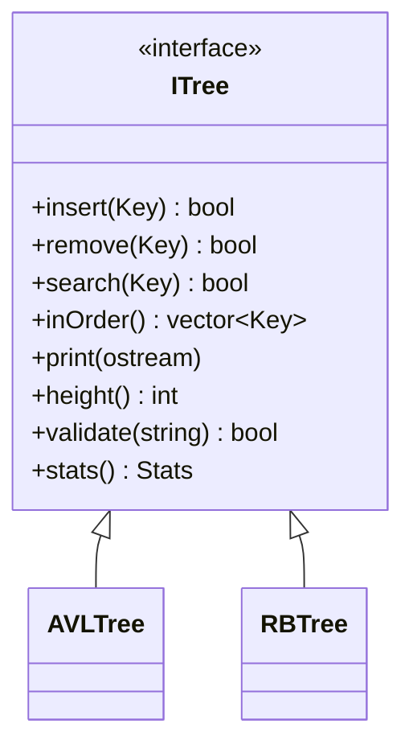

<div align="center">

# 🌳 Amazon Engineering Challenge
### Árvores Balanceadas: AVL e Rubro-Negra


**Autor:** Diogo Roger de Medeiros Silva · **Matrícula:** 20250041466
**Disciplina:** IMD0039 — Estruturas de Dados Básicas II · Instituto Metrópole Digital (UFRN)
**Trabalho referente a Unidade II**

</div>

> Protótipo de um sistema de logística para a **Black Friday**: registrar, localizar e remover
> identificadores de encomendas com eficiência. O projeto implementa **do zero** uma árvore **AVL** e
> uma árvore **Rubro-Negra** (sem `std::set`/`std::map` ou qualquer biblioteca de balanceamento) e
> compara as duas com os mesmos dados e as mesmas operações.

---

## Sumário

- [Funcionalidades](#funcionalidades)
- [Estrutura do repositório](#estrutura-do-repositório)
- [Início rápido](#início-rápido)
- [Compilação e execução](#compilação-e-execução)
- [Exemplo de uso](#exemplo-de-uso)
- [Decisões de implementação](#decisões-de-implementação)
- [Testes](#testes)
- [Resultados da análise comparativa](#resultados-da-análise-comparativa)
- [Referências](#referências)

---

## Funcionalidades

O usuário escolhe, **em tempo de execução**, qual árvore usar (AVL ou Rubro-Negra). Em ambas há:

| Operação | Descrição |
|---|---|
| **Inserção** | Insere um identificador (`long long`); valores duplicados são ignorados |
| **Inserção em lote** | Vários valores de uma vez, separados por espaço |
| **Remoção** | Remove um identificador; se não existir, informa e deixa a árvore inalterada |
| **Busca** | Informa se o identificador existe |
| **Percurso em ordem** | Elementos em ordem crescente |
| **Impressão da árvore** | Desenho "deitado"; na Rubro-Negra cada nó mostra `(R)` ou `(B)` (cores ANSI com `--color`) |
| **Estatísticas** | Tamanho, altura, altura mínima teórica, rotações e recolorações |
| **Verificação de propriedades** | Valida ordem BST e todos os invariantes de balanceamento |
| **Carga automática** | Insere N chaves em ordem crescente, decrescente ou aleatória (semente fixa) |
| **Modo detalhado** | Mostra cada caso de balanceamento, rotação e recoloração executados |

Além do programa principal, o repositório traz um **demo** (exemplos "antes e depois" de rotações e
ajustes de cor) e uma **suíte de testes** com a análise comparativa.

## Estrutura do repositório

```
.
├── src/
│   ├── tree.hpp            # interface comum (ITree), tipo Key e contadores (Stats)
│   ├── avl_tree.hpp/.cpp   # árvore AVL
│   ├── rb_tree.hpp/.cpp    # árvore Rubro-Negra
│   ├── main.cpp            # programa interativo (menu)
│   └── demo.cpp            # exemplos de rotação / ajuste de cores
├── tests/
│   └── tests.cpp           # testes automatizados + tabela comparativa
├── bin/                    # executáveis compilados (Windows)
├── Makefile
└── README.md
```

Ambas as árvores implementam a mesma interface `ITree`, o que permite escolher a estrutura em
tempo de execução e aplicar **exatamente as mesmas sequências de operações** nas duas:



## Início rápido

**Windows:** abra um terminal na pasta do projeto e rode direto os executáveis de `bin/`:

```powershell
chcp 65001
.\bin\testes.exe      # testes + análise comparativa
.\bin\arvores.exe     # programa interativo
.\bin\demo.exe        # exemplos de rotação antes/depois
```

> Os executáveis são de 32 bits para Windows. Em Linux/macOS, compile a partir do código-fonte (próxima seção).

## Compilação e execução

**Requisitos:** compilador com **C++17** (g++ ≥ 9, clang ≥ 10 ou MSVC 2019+). Nenhuma dependência externa.

<details open>
<summary><b>Linux / macOS / MSYS2 (com make)</b></summary>

```bash
make                 # gera bin/arvores, bin/testes e bin/demo
make test            # compila e roda os testes
```

</details>

<details>
<summary><b>Qualquer sistema com g++ (sem make)</b></summary>

```bash
mkdir -p bin
g++ -std=c++17 -O2 -Isrc src/main.cpp src/avl_tree.cpp src/rb_tree.cpp -o bin/arvores
g++ -std=c++17 -O2 -Isrc src/demo.cpp src/avl_tree.cpp src/rb_tree.cpp -o bin/demo
g++ -std=c++17 -O2 -Isrc tests/tests.cpp src/avl_tree.cpp src/rb_tree.cpp -o bin/testes
```

No PowerShell, crie a pasta com `mkdir bin` e use `-o bin/arvores.exe` (e equivalentes).

</details>

**Execução:**

```bash
./bin/arvores              # escolhe a árvore no menu inicial
./bin/arvores avl          # já inicia com a AVL
./bin/arvores rb --color   # Rubro-Negra com nós vermelhos coloridos
./bin/demo                 # exemplos antes/depois de rotações
./bin/testes               # testes + comparação (código de saída 0 se tudo passar)
```

> No `cmd`/PowerShell, rode `chcp 65001` antes para exibir os acentos corretamente.

## Exemplo de uso

```text
Opção: 2
Valores: 10 20 30 40 50 25
  inseridos: 6 | duplicados ignorados: 0 | entradas inválidas: 0
Opção: 6
  (raiz à esquerda; subárvore direita em cima, esquerda embaixo)
  Legenda: (R) = vermelho, (B) = preto
                50(B)
        40(R)
                30(B)
                        25(R)
20(B)
        10(B)
```

Com o **modo detalhado** ligado (opção 10), cada ajuste é narrado, por exemplo:

```text
[AVL] desbalanceamento em 30: caso Esquerda-Esquerda (LL)
[AVL] rotação à direita em 30 (20 sobe)
```

## Decisões de implementação

| Tema | Decisão |
|---|---|
| **Chaves** | `long long`, aceitando valores negativos e grandes |
| **Valores repetidos** | Inserção **recusada** (`false`); a árvore não muda e nenhuma rotação ocorre |
| **Busca/remoção de inexistentes** | Retornam `false` sem alterar a árvore; o menu informa o usuário |
| **Convenção de altura** | Em **nós**: árvore vazia = 0, um nó = 1 (a mesma nas duas árvores) |
| **AVL** | Recursiva; rebalanceia na volta da recursão (casos LL, RR, LR, RL). Na remoção com dois filhos, usa o **sucessor em ordem** |
| **Rubro-Negra** | Estilo CLRS: ponteiro para o pai e **sentinela NIL preta**. Inserção com 3 casos (tio vermelho / zigue-zague / mesma linha) e remoção com 4 casos |
| **Métricas** | `rotations` conta rotações simples (uma dupla = 2); `recolorings` conta só mudanças reais de cor |
| **Validação** | `validate()` verifica em O(n) a ordem BST e os invariantes (AVL: fator de balanceamento e alturas; RB: raiz preta, sem vermelho-vermelho, mesma altura-negra, ponteiros de pai) |
| **Impressão grande** | O menu omite a impressão de árvores com mais de 128 nós (use as estatísticas) |

## Testes

`testes` executa a **mesma bateria nas duas árvores** (94.850 verificações):

| Cenário exigido | Como é testado |
|---|---|
| Árvore vazia / com 1 elemento | busca, remoção, percurso, altura e impressão |
| Inserção crescente, decrescente e aleatória | 500 chaves, propriedades validadas **a cada inserção** |
| Busca de existentes e inexistentes | todos os inseridos são achados; chaves fora do intervalo não |
| Remoção com diferentes configurações de filhos | remove **cada nó** de árvores de 31 elementos (folha, um filho, dois filhos, raiz) |
| Remoção de inexistentes e valores repetidos | retorno `false`, árvore e contadores inalterados |
| Propriedades após inserções e remoções | `validate()` a cada passo + 20.000 operações mistas comparadas com `std::set` (usado **só como oráculo** nos testes) |
| Limite teórico de altura | AVL ≤ 1,4405·log₂(n+2) − 0,3277; Rubro-Negra ≤ 2·log₂(n+1) |

## Resultados da análise comparativa

Mesmos dados e mesmas operações nas duas árvores: inserir *n* chaves e depois remover metade delas
(ordem aleatória, semente 7). Altura contada em nós. Saída gerada por `testes`.

**n = 10.000** (altura mínima possível: 14)

| Inserção | Árvore | Altura (ins.) | Rotações (ins.) | Recolorações (ins.) | Altura final | Rotações (total) |
|---|---|---:|---:|---:|---:|---:|
| crescente | AVL | 14 | 9.986 | — | 14 | 10.804 |
| crescente | Rubro-Negra | 24 | 9.976 | 49.877 | 14 | 10.914 |
| decrescente | AVL | 14 | 9.986 | — | 14 | 10.845 |
| decrescente | Rubro-Negra | 24 | 9.976 | 49.877 | 15 | 10.963 |
| aleatória | AVL | 16 | 6.999 | — | 15 | 8.864 |
| aleatória | Rubro-Negra | 16 | 5.786 | 23.173 | 16 | 7.600 |

<details>
<summary><b>Tabela completa (n = 1.000, 10.000 e 100.000)</b></summary>

| Inserção | n | Árvore | Alt. (ins.) | Rot. (ins.) | Rec. (ins.) | Alt. final | Rot. (total) | Rec. (total) |
|---|---:|---|---:|---:|---:|---:|---:|---:|
| crescente | 1.000 | AVL | 10 | 990 | 0 | 10 | 1.075 | 0 |
| crescente | 1.000 | Rubro-Negra | 17 | 983 | 4.909 | 11 | 1.087 | 6.105 |
| decrescente | 1.000 | AVL | 10 | 990 | 0 | 10 | 1.082 | 0 |
| decrescente | 1.000 | Rubro-Negra | 17 | 983 | 4.909 | 10 | 1.096 | 6.122 |
| aleatória | 1.000 | AVL | 12 | 728 | 0 | 11 | 923 | 0 |
| aleatória | 1.000 | Rubro-Negra | 12 | 571 | 2.290 | 11 | 738 | 3.131 |
| crescente | 10.000 | AVL | 14 | 9.986 | 0 | 14 | 10.804 | 0 |
| crescente | 10.000 | Rubro-Negra | 24 | 9.976 | 49.877 | 14 | 10.914 | 61.922 |
| decrescente | 10.000 | AVL | 14 | 9.986 | 0 | 14 | 10.845 | 0 |
| decrescente | 10.000 | Rubro-Negra | 24 | 9.976 | 49.877 | 15 | 10.963 | 62.087 |
| aleatória | 10.000 | AVL | 16 | 6.999 | 0 | 15 | 8.864 | 0 |
| aleatória | 10.000 | Rubro-Negra | 16 | 5.786 | 23.173 | 16 | 7.600 | 32.017 |
| crescente | 100.000 | AVL | 17 | 99.983 | 0 | 17 | 108.529 | 0 |
| crescente | 100.000 | Rubro-Negra | 31 | 99.969 | 499.846 | 19 | 109.441 | 620.933 |
| decrescente | 100.000 | AVL | 17 | 99.983 | 0 | 17 | 108.337 | 0 |
| decrescente | 100.000 | Rubro-Negra | 31 | 99.969 | 499.846 | 19 | 109.398 | 620.894 |
| aleatória | 100.000 | AVL | 20 | 69.589 | 0 | 19 | 88.102 | 0 |
| aleatória | 100.000 | Rubro-Negra | 20 | 58.569 | 231.932 | 20 | 76.491 | 319.591 |

</details>

**O que os números mostram**

- Em cargas **ordenadas** (crescente/decrescente), a AVL fica com a altura mínima possível (14 para n = 10.000), enquanto a Rubro-Negra chega a 24, ou seja, buscas mais longas.
- Em carga **aleatória**, as alturas empatam (16), e a Rubro-Negra realiza menos rotações (5.786 contra 6.999 nas inserções).
- A Rubro-Negra compensa as rotações com muitas **recolorações** (O(1) por operação, sem reestruturar a árvore).

<!-- TODO: acrescentar aqui a recomendação técnica final com suas palavras (também vai no slide de recomendação do PDF). -->

## Referências

- CORMEN, T. H. et al. *Algoritmos: Teoria e Prática* (*Introduction to Algorithms*), cap. 13 — Árvores Rubro-Negras.
- ADEL'SON-VEL'SKII, G. M.; LANDIS, E. M. *An algorithm for the organization of information*, 1962 (árvore AVL).
- SEDGEWICK, R.; WAYNE, K. *Algorithms*, 4ª ed. — árvores de busca balanceadas.
- Material da disciplina IMD0039 (UFRN).

---

<div align="center">

Trabalho individual desenvolvido por **Diogo Roger de Medeiros Silva** para a disciplina IMD0039 — Estruturas de Dados Básicas II (UFRN).

</div>
